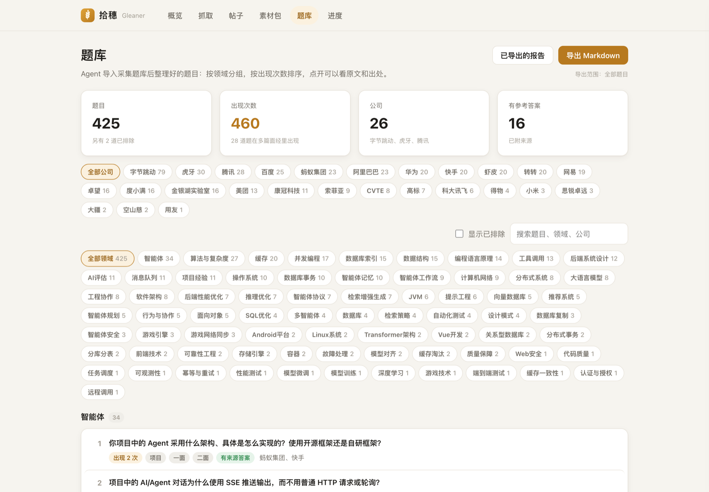
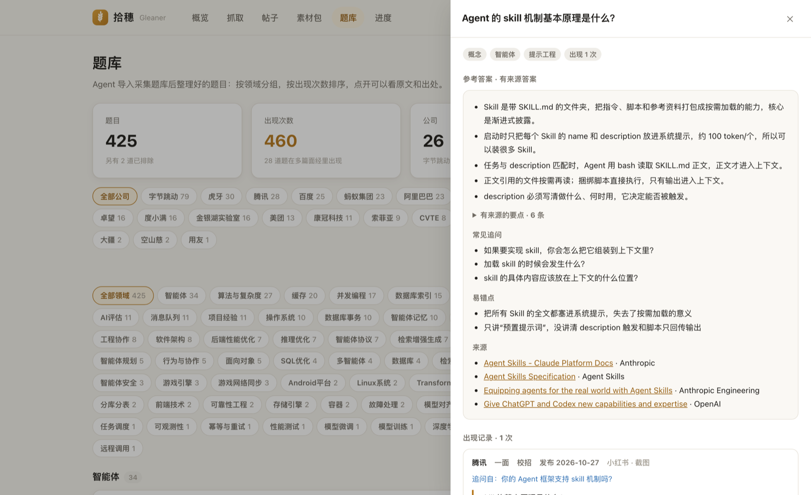
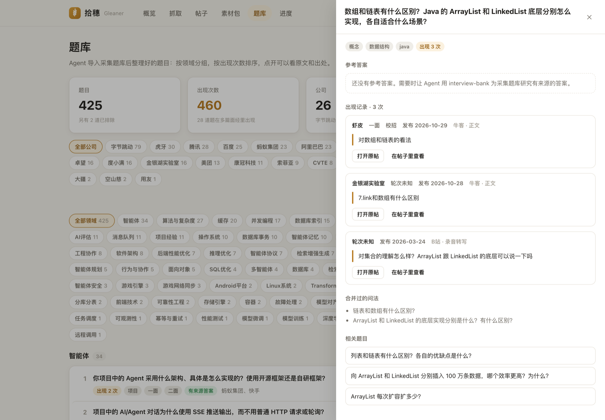
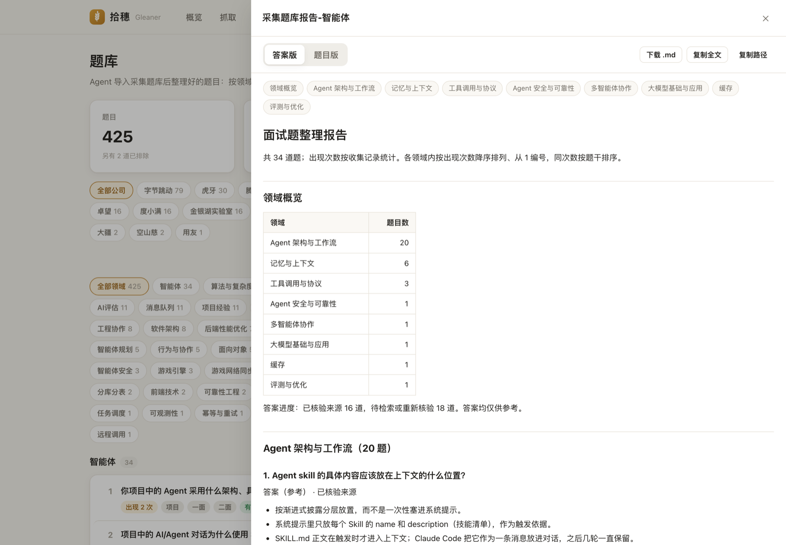
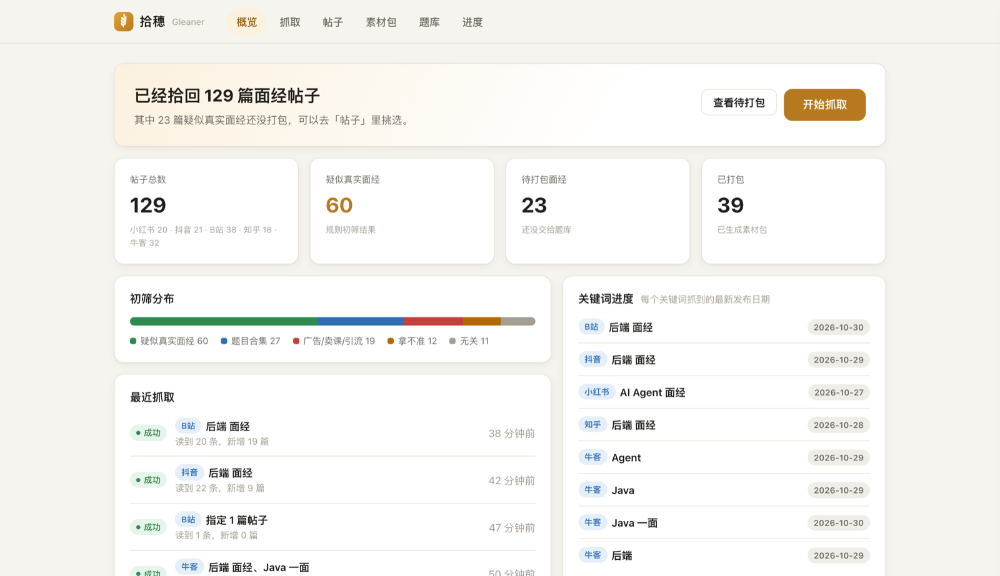

# Gleaner · 拾穗

把散落在小红书、抖音、B 站、知乎和牛客上的真实面经一穗一穗捡回来：前四个平台调用你本机的
[MediaCrawler](https://github.com/NanmiCoder/MediaCrawler) 小批量抓取，牛客由 Gleaner 直接读取公开的面经帖子；
按帖子去重、规则初筛，再打成素材包，交给 [Interview Bank](https://github.com/EXIST-D/Interview-bank) 导入一个**独立的采集题库**。

Gleaner 只负责“发现 → 抓取 → 筛选 → 打包”。题目抽取、分类、同义题合并和参考答案仍由 Interview Bank 完成，
所以主项目的保守去重原则（拿不准就交给你裁决）同样适用于采集来的题。

当前版本 **0.1.0**（未发布的改动见 [CHANGELOG](CHANGELOG.md)）。

| 平台 | 代码 | 抓取方式 | 导入内容 |
|---|---|---|---|
| 小红书 | `xhs` | MediaCrawler，扫码登录；搜索每页 20 篇 | 正文 + 图文帖的图片 |
| 抖音 | `dy` | MediaCrawler，扫码登录；搜索每页 10 篇 | 文案 + 图集的图片；视频帖只用文案 |
| B 站 | `bili` | MediaCrawler，扫码登录；搜索每页 20 个 | 标题和简介；面试录音可以下载音视频，交给 Interview Bank 转写 |
| 知乎 | `zhihu` | MediaCrawler，扫码登录；搜索每页 20 条 | 回答、文章的纯文字正文 |
| 牛客 | `nowcoder` | Gleaner 直接读取，不登录、不用站内搜索 | 讨论帖和动态的正文 + 图片 |

## 效果展示

下面是作者本机网页控制台的真实截图：从五个平台抓回的面经，经 Interview Bank 抽题、合并同义题后整理成的采集题库。

**题库**：按领域分组、按出现次数排序，可以按公司和领域筛选。



**一道题的全貌**：有来源的参考答案（附常见追问、易错点和引用链接），下面是每次出现的公司、轮次、平台、来源类型和原文摘录（截图里截掉了原帖图片）。



**跨平台合并**：牛客两篇帖子里的写法和一段 B 站面试录音转写出来的问法，合并成同一道题，出现 3 次；合并过的问法和相关题目都列在下面。



**导出的报告**：按公司或领域导出答案版和题目版 Markdown，可以在线预览。



**概览**：各平台的帖子数、初筛分布、每个关键词抓到的最新日期和最近几次抓取。



## 工作方式

```text
MediaCrawler（你本机、你自己的登录）   Gleaner 牛客读取器（公开的面经列表与帖子）
        │  jsonl + 图片                      │  同样的 jsonl + 图片布局
        └──────────────┬─────────────────────┘
                       ▼
gleaner crawl / import ──► 工作区 SQLite：帖子按「平台 + 帖子 ID」去重，记录每个关键词的最新发布时间
        │
        ▼
gleaner screen ──► 规则初筛：疑似真实面经 / 题目合集 / 广告卖课 / 无关 / 拿不准（只打标签，不删除）
        │
        ▼
gleaner pack ──► 素材包：manifest.json + 每篇的 body.txt 与图片（录音是 audio.flac）+ HANDOFF.md（含导入命令）
        │
        ▼
Interview Bank（Agent）──► 采集题库：ingest images / web-intake / media 转写 → 抽题 → 去重 → 提交
```

为什么是独立的采集题库：个人题库的出现次数代表“你自己搜集到的面经”，批量抓来的帖子如果混进去，
就分不清哪些是市场上的高频题、哪些是你亲身遇到的。采集题库单独统计，需要的题再通过 JD 选题或人工挑选放进个人题库。

### 从抓取到题库：哪些是自动的

| 步骤 | 谁来做 | 怎么做 |
|---|---|---|
| 安装依赖、打补丁、建采集题库、装转写工具 | 自动 | `gleaner setup` |
| 登录小红书、抖音、B 站、知乎 | **你**：扫码 | 第一次抓取时弹出窗口；登录状态保存在 `MediaCrawler/browser_data/`，过期了再扫一次。牛客不用登录 |
| 抓取、去重、初筛 | 自动 | `gleaner crawl`（默认增量），或网页的抓取页 |
| 以上加下载录音、打包，一条命令走完 | 自动 | [`gleaner auto`](#一条命令走完抓取到打包gleaner-auto)，可交给定时任务 |
| 复核初筛标签 | 可选，你 | `gleaner label` 或网页的帖子页；不复核也能打包，只打「疑似真实面经」 |
| 下载 B 站面试录音 | 自动 | `gleaner media` |
| 打包、提取音频 | 自动 | `gleaner pack`，生成带导入命令的 HANDOFF.md |
| 转写录音 | Agent 运行 HANDOFF.md 里的命令 | 本机 faster-whisper，不联网 |
| 抽题、分类、合并同义题、提交 | Agent（interview-bank skill） | 拿不准的合并会列出来交给你裁决 |
| 参考答案 | Agent，可选 | 为采集题库检索有来源的答案 |
| 浏览、筛选、导出 | 网页的题库页 | 只读，导出 Markdown 报告 |

也就是说，除了扫码登录和交给 Agent 的抽题、答案两步，其余都是一条命令。还没打通的地方：

- 素材包有没有导入题库：`gleaner imports` 向 Interview Bank 的 `sources` 命令要来题库已有的来源，按链接对照帖子，
  列出还在等导入的素材包（要装有 `sources` 命令的 Interview Bank；`doctor` 会检查它有没有 Gleaner 用到的命令）。
  没经过素材包、手工导入的帖子会顺手记成「手工导入」，以后不会再打包，也不会再自动下载它的录音，`gleaner auto`
  每次运行都会先做这一步。抽题时发现没有题、或者根本没导的帖子会显示成「还没进题库」；决定不导入的用
  `gleaner imports --skip <帖子键>` 记下，手工导入的用 `--mark`，记错了用 `--clear`。
- 登录过期要回来扫码：`gleaner auto` 遇到要扫码的平台会跳过并写明原因（退出码 3），手动运行一次 `gleaner crawl <平台>` 扫码即可。

### 一条命令走完：抓取到打包（`gleaner auto`）

```bash
gleaner auto --dry-run     # 先看看会做什么：每个平台的搜索范围、要下载的录音、能打包几篇
gleaner auto               # 增量抓取各平台 → 下载新的 B 站面试录音 → 打包
```

每一步都是 `crawl`、`media`、`pack` 已有的逻辑，只是串了起来：

1. 按 `[auto] platforms` 的顺序（默认全部，牛客最先，它不用登录）增量搜索配置里的关键词。
   同一平台刚抓过就跳过这一步，不算失败；一个平台降级了，其余平台照常运行。
2. B 站这次搜索成功的话，下载最多 `[auto] max_recordings`（默认 2）个标成录音的视频，一次一个；
   两次 B 站运行之间照样等够最小间隔，一个下载失败就不再下载后面的。
3. 对照采集题库（见上文 `gleaner imports`）：手工导入过的帖子记下来，所以不会重复下载和打包。
4. 打包可以打包的帖子（`candidate` 且没打过包）。**还没下载的录音不打包**：先打包的话只会导入标题，
   而且打过包就不会再自动下载了；`gleaner pack` 默认也是这样，会提示还有几个录音等下载。
5. 最后列出每一步的结果，给出 HANDOFF.md 的位置，并提醒还有几个素材包在等导入。

它**不会等你扫码**：MediaCrawler 一问二维码就停掉这个平台，记为降级，所以可以放心交给定时任务；
第一次或登录过期时，加 `--login`（或直接 `gleaner crawl <平台>`）手动扫一次。
常用参数：`--platform` 只处理几个平台、`--no-media`、`--no-pack`、`--full`（不做增量）、`--force`（忽略最小间隔）。
同一工作区同一时间只能有一个 `gleaner auto`，用 `workspace/auto.lock` 把关，上一次崩溃留下的锁 12 小时后自动作废。

交给系统的定时任务来运行（Gleaner 不会替你创建计划任务）。MediaCrawler 会打开一个 Chrome 窗口，
所以要在有桌面的登录会话里运行，不要放在没有桌面的服务器上：

```bash
# macOS / Linux：crontab -e 加一行，每天 09:30 运行，输出追加到 workspace/auto.log
30 9 * * * cd /path/to/Gleaner && .venv/bin/gleaner --workspace workspace auto --quiet >> workspace/auto.log 2>&1
```

```bat
:: Windows：每天 09:30（在命令提示符里运行一次即可创建）
schtasks /Create /SC DAILY /ST 09:30 /TN Gleaner /TR "cmd /c cd /d C:\path\to\Gleaner && .venv\Scripts\gleaner --workspace workspace auto --quiet >> workspace\auto.log 2>&1"
```

**放到云端服务器定时运行**要先想清楚三件事（没在云服务器上验证过，以下是 MediaCrawler 的工作方式决定的）：

- 牛客不登录、不需要浏览器，最适合放云端；小红书、抖音、B 站、知乎要用 Chrome 扫码登录，云服务器没有桌面，
  第一次登录（和过期后重新登录）得在能看到二维码的机器上做，登录状态在 `MediaCrawler/browser_data/` 里，和那台机器绑定。
- 机房 IP 抓这些平台更容易被风控；`gleaner auto` 遇到验证或二维码会停下，不会绕过。
- 转写录音要用 faster-whisper（`large-v3-turbo` 约需 3GB 内存、一小时录音转十几分钟），内存小的服务器跑不动。
  可以只在云端跑 `--platform nowcoder`（加 `--no-media`），其余平台和转写留在本机。

另外同一份数据库只能在一台机器上抓（SQLite 没有合并工具）；云端和本机各抓一部分的话，要换着用时整份 `workspace/` 拷过去。
网页概览的「最近一次自动运行」读的是 `workspace/last-auto.json`，所以它显示的是这份工作区上最近一次 `gleaner auto`。

## 环境要求

自己准备的只有三样，其余的都由 `gleaner setup` 一条命令装好：

- Python **3.11+**，Gleaner 本身只用标准库。
- [git](https://git-scm.com/)：下载 MediaCrawler 和 Interview Bank，给 MediaCrawler 打补丁。
- [uv](https://docs.astral.sh/uv/)：MediaCrawler 用它装依赖。macOS/Linux 用
  `curl -LsSf https://astral.sh/uv/install.sh | sh` 安装，Windows 用
  `powershell -c "irm https://astral.sh/uv/install.ps1 | iex"`。

另外最好装有 Chrome 或 Edge：MediaCrawler 会用它单独打开一个窗口让你扫码登录，没有的话 `setup` 会改装 Playwright 的 Chromium。
导入素材包时需要一个支持 Agent Skills 的 Agent（读 HANDOFF.md 抽题）。只抓牛客的话 MediaCrawler 可以不装，见 [牛客读取](docs/nowcoder.md)。

## 快速开始

```bash
# 1. 安装 Gleaner（在本仓库目录）
python3 -m venv .venv && .venv/bin/pip install -e .      # Windows：py -3.11 -m venv .venv; .venv\Scripts\pip install -e .
export PATH="$PWD/.venv/bin:$PATH"
export GLEANER_HOME="$PWD/workspace"                      # 工作区放在仓库下的 workspace/，已被 git 忽略

# 2. 一条命令装好其余的一切（可以重复运行，装好的会跳过）
gleaner setup

# 3. 检查环境：每一项都应该是 ✓
gleaner doctor

# 4. 小批量抓取（搜索按页返回，每个关键词默认一页；同一平台两次至少间隔 5 分钟）
gleaner crawl xhs --keyword "后端 面经"
gleaner crawl xhs --url "https://www.xiaohongshu.com/explore/<帖子ID>?xsec_token=..."
gleaner crawl bili --keyword "Java 面试 复盘"
gleaner crawl nowcoder --keyword "后端 一面" --max-notes 10   # 在最新面经里找标题或摘要含“后端”和“一面”的
gleaner crawl nowcoder --url "https://www.nowcoder.com/discuss/<帖子ID>"

# 5. 看初筛结果，必要时人工改标签
gleaner list --label candidate --platform nowcoder
gleaner show xhs:<帖子ID>
gleaner label xhs:<帖子ID> promo --reason "结尾在卖课"

# 6. 打包，把 HANDOFF.md 交给装了 interview-bank 的 Agent
gleaner pack --limit 20
```

### `gleaner setup` 装了什么

分三部分，可以只装其中几部分（例如只抓牛客：`gleaner setup bank`），每一部分装好的都会跳过：

| 部分 | 内容 |
|---|---|
| `mediacrawler` | 把 [MediaCrawler](https://github.com/NanmiCoder/MediaCrawler) 下载到仓库旁边的 `MediaCrawler/` 并固定到验证过的版本，打上 Gleaner 的补丁（见 [MediaCrawler 接入](docs/mediacrawler.md)），`uv sync` 装依赖；没有 Chrome 或 Edge 时再装 Playwright 的 Chromium |
| `bank` | 把 [Interview Bank](https://github.com/EXIST-D/Interview-bank) 下载到工作区旁边的 `Interview-bank/`，用它新建独立的采集题库 `collected-bank/`；配置的 Python 低于 3.10 时改用运行 Gleaner 的 Python |
| `media` | 转写 B 站面试录音用的工具：在 `workspace/asr-venv/` 装 `faster-whisper`；系统里没有 ffmpeg 时装 `imageio-ffmpeg` 并在 `workspace/bin/ffmpeg` 放一个链接；再把转写模型（约 1.5 GB）下载到采集题库的缓存里，`--no-model` 跳过，第一次转写时再下载 |

装到哪里都会写进 `gleaner.toml`（用相对路径），已经配好、能用的路径不会被改掉。MediaCrawler 和 Interview Bank 都是各自下载、
不随 Gleaner 分发的，许可证也各自适用。补丁和本机对 MediaCrawler 的改动冲突时，`setup` 会停下并说明，不会覆盖你的改动。

### 增量抓取

按关键词搜索时默认是增量的：只找上次成功搜索这些关键词之后发布的帖子（往前多留 1 天，防止漏掉刚发的）。
各平台能做到的程度不同：

- **牛客**：跳过已经保存过的帖子，翻到一整页都是上次搜索之前发布的就不再往后翻。
- **B 站**：按发布时间搜索，精确到分钟。
- **抖音、知乎**：平台只能选「一天内 / 一周内 / 半年内」这类固定范围，取能覆盖上次搜索时间的最小范围；隔得太久就不限时间。
- **小红书**：不能按发布时间搜索，照常按最新排序抓取，已有的帖子只更新。

换了关键词（有一个从没成功搜过）、或者上次搜索降级了，都不算数，这一次不限时间。想全部重新读一遍用 `gleaner crawl <平台> --full`，
网页的抓取页在「高级」里勾选「不做增量」。抓取开始时会打印这一次用的范围，例如「增量：只搜 2026-10-28 10:28 之后发布的帖子」。

已经用 MediaCrawler 的 WebUI 或命令行抓过的数据，可以直接导入：`gleaner import <MediaCrawler 的 data 目录>`，
里面的 `xhs/`、`douyin/`、`bili/`、`zhihu/` 会一起导入（其他平台的目录会跳过）。

帖子键是 `平台代码:帖子 ID`，例如 `xhs:6650a1b2c3d4`、`dy:7300…`、`bili:115…`（av 号，BV 链接也能认出）、
`zhihu:answer-…` / `zhihu:article-…`、`nowcoder:945…`（讨论帖）或 `nowcoder:<32 位 UUID>`（动态）。

### B 站面试录音

B 站上有人把自己的真实面试录下来发成视频，题都在声音里。初筛会把标题或简介里有“录音”“实录”“面试全程”
“真实面试”这类词的视频标成录音（理由里是 `recording:<词>`），这些视频可以下载下来，打包时转成音频交给 Interview Bank 转写：

```bash
gleaner media --dry-run                 # 看看哪些视频会下载：标成录音、还没下载、也没打包的
gleaner media                           # 一个接一个下载（半小时的录音可能要十几分钟）
gleaner media bili:<av 号>               # 或者只下载指定的视频；要先 `gleaner crawl bili --url <链接>` 把帖子读进来
gleaner pack --key bili:<av 号>          # 打包时用 ffmpeg 提取单声道音频并做响度均衡，生成 audio.flac
```

需要的工具 `gleaner setup media` 都会装好：

- **ffmpeg**：B 站的画面和声音分开下载，MediaCrawler 用它合成（找不到时会退回低清晰度、可能不完整的视频）；
  打包时也用它提取音频。想用自己的 ffmpeg 就在 `[media] ffmpeg` 写路径，文件名必须叫 `ffmpeg`（可以是链接）。
- **转写用的 Python**：装了 `faster-whisper` 的 Python，路径在 `[handoff] asr_python`。
  HANDOFF.md 里的 `media` / `media-transcribe` / `media-task` 命令都用它运行；默认模型 `large-v3-turbo`（约 1.5 GB），
  只在本机运行，在 CPU 上转写一段录音大约要录音时长的 1/6 到 1/3。

转写文本会听错专业词（例如 Redis 听成 Lilis，幂等听成密等），远程面试里面试官的声音也常常太小没转出来，
所以 HANDOFF.md 要求 Agent 逐题改正并在 `correction` 里说明，只有回答能清楚看出问题时才补出题目。

## 网页控制台

```bash
gleaner --workspace workspace web          # 打开 http://127.0.0.1:8765/
```

上面这些步骤都可以在浏览器里完成，不用记命令：

- **概览**：帖子数、初筛分布、待打包数量、每个平台上每个关键词抓到的最新日期、最近几次抓取和环境检查。
- **抓取**：先选平台，再填关键词（回车添加）、选每个关键词抓几页（牛客选篇数），点“开始抓取”。页面按平台显示步骤
  （例如小红书是 启动浏览器 → 登录 → 搜索 → 下载 → 导入与初筛，牛客是 翻阅面经列表 → 读取帖子 → 下载图片 → 导入与初筛），
  需要扫码、输入验证码或点确认框时会醒目提示（扫码按 MediaCrawler 的 10 分钟等待倒计时），牛客要求放慢时会提示正在等待；
  下方是实时日志，可以随时停止。批量上限、同一平台两次抓取的最小间隔、去重和初筛与命令行完全相同。
  B 站按链接抓取时可以勾选“同时下载音视频”。
- **帖子**：按平台、标签、是否打包筛选或搜索；卡片上能看到封面、平台、标签，以及打包时会“读正文”还是“看图”，
  B 站视频会标出“面试录音”或“录音 · 已下载”。点开一篇可以看全部图片和正文、一键改标签、打开原帖；
  B 站视频有“下载音视频”按钮（会转到抓取页看进度）；勾选后点“打包所选”。
- **素材包**：每个包的 HANDOFF.md，命令可以一键复制。
- **题库**：Agent 导入采集题库后整理好的题目。按领域分组、按出现次数排序，可以按公司、领域筛选或搜索；
  点开一道题能看到参考答案（有的话）、每次出现的原文、公司、轮次、平台和来源类型（正文、截图、录音转写）、来源截图，以及原帖和 Gleaner 帖子的链接，
  还有合并过的问法和相关题目。这一页只读，通过 Interview Bank 的命令行读取，不改动题库。
  “导出 Markdown”按当前选中的公司和领域（含子领域）生成答案版和题目版两份报告，保存在采集题库的 `exports/`；
  “已导出的报告”可以在线预览（目录跳转、两版切换）、下载 `.md`、复制全文或路径。
- **进度**：本机的开发记录（工作区里的 `开发进度.md`，没有就显示开发手册的「当前状态」）、`CHANGELOG.md` 里还没发布的改动、
  最近的提交和未提交/未推送的数量。右边可以按页面写意见，追加保存到工作区的 `意见.md`，供下次开发时处理。

概览和进度页每 30 秒自动刷新，抓取结果和新的提交不用手动刷新也能看到。

控制台只监听 `127.0.0.1`，拒绝其他 Host 的请求，写操作需要页面里的随机令牌，并启用了严格的内容安全策略。
`#posts?open=<帖子键>`、`#packs?open=<包编号>`、`#bank?open=<题目编号>`、`#bank?report=<文件名>`
可以直接打开某篇帖子、素材包、题目或导出的报告。

## 命令

| 命令 | 作用 |
|---|---|
| `init` | 创建工作区：`gleaner.toml`、`gleaner.db`、`runs/`、`packs/` |
| `setup [部分…]` | 创建工作区并装好 MediaCrawler（含补丁）、Interview Bank 与采集题库、转写工具；部分是 `mediacrawler` `bank` `media`，不写就全装；`--no-model` 不下载转写模型 |
| `doctor` | 检查 MediaCrawler 目录、启动命令和补丁、默认关键词、`ibank.py`、采集题库、导入用的 Python 版本、ffmpeg 和转写用的 Python |
| `crawl <平台>` | `xhs` `dy` `bili` `zhihu` 调用 MediaCrawler，`nowcoder` 直接读取；`--keyword` 搜索或 `--url` 指定帖子，随后导入并初筛；搜索默认增量，`--full` 不限发布时间 |
| `auto` | 增量抓取各平台 → 下载新的 B 站面试录音 → 打包，遇到要扫码的平台就跳过；`--dry-run` 只列出计划，`--platform`、`--no-media`、`--no-pack`、`--login`、`--full`、`--force`，见上文 |
| `media [key…]` | 下载 B 站面试录音的音视频；不写帖子键就下载初筛标成录音、还没下载也没打包的视频；`--dry-run` 只列出 |
| `import <dir>` | 导入已有的 MediaCrawler（或 Gleaner 自己的 `runs/<id>/raw`）输出目录 |
| `screen [--all]` | 对未打标签的帖子初筛；`--all` 重判以前的规则标签，人工标签不动 |
| `list` / `show` | 查看帖子、标签和初筛理由；`list --platform` 按平台筛选 |
| `label <key> <label>` | 人工改标签，以后的初筛不会覆盖 |
| `pack` | 打包（默认只打 `candidate` 且没打过包的帖子；还没下载的录音先留着） |
| `imports` | 对照采集题库：哪些帖子已经导入、哪些素材包还在等导入；`--mark`、`--skip`、`--clear` 记下手工导入、不打算导入的帖子或去掉记录；`--dry-run` 只列出 |
| `glossary` | 列出转写录音时常被听错的术语（内置的加上 `[glossary] extra`）；有录音的素材包的 HANDOFF.md 里也附这张表 |
| `web` | 打开本机网页控制台（`--port` 换端口，`--no-open` 不自动打开浏览器） |
| `stats` / `runs` | 统计与抓取记录 |

所有命令都支持 `--json`。工作区用 `--workspace` 或环境变量 `GLEANER_HOME` 指定。
退出码：0 成功，1 出错，3 抓取降级（例如登录过期，已产出的部分仍会导入）。

## 目录结构

所有运行数据都放在仓库目录里，并且全部被 git 忽略：

```text
Gleaner/
├── src/ tests/ docs/      # 代码与文档（进 git）
├── MediaCrawler/          # gleaner setup 下载并打好补丁的 MediaCrawler，含 browser_data/ 登录状态
├── Interview-bank/        # gleaner setup 下载的 Interview Bank（已经另外装过的话用你配置的那份）
├── collected-bank/        # 独立的采集题库（Interview Bank 格式），cache/asr/ 是转写模型
└── workspace/             # Gleaner 工作区（GLEANER_HOME）
    ├── gleaner.toml       # 配置；路径相对本文件，默认指向 ../MediaCrawler 和 ../collected-bank
    ├── gleaner.db         # 帖子、标签、抓取记录、关键词进度
    ├── asr-venv/ bin/     # 转写用的 Python（faster-whisper）和 ffmpeg 链接
    ├── runs/<run-id>/
    │   ├── mediacrawler.log   # MediaCrawler 的完整输出（牛客是 nowcoder.log）
    │   └── raw/<平台目录>/     # 原始导出（jsonl + media/），如 xhs/、douyin/ 与 dy/、nowcoder/；B 站录音在 bili/media/<BV 号>/
    └── packs/<pack-id>/   # 交给 Interview Bank 的素材包，格式见 docs/pack-format.md
```

配置里用相对路径，整个 `Gleaner/` 目录挪到别处也不用改。挪动后要重建虚拟环境：
仓库的 `.venv`、`MediaCrawler/.venv` 和 `workspace/asr-venv`，因为里面写着绝对路径；删掉 `workspace/asr-venv`
后运行 `gleaner setup` 就会重建（`MediaCrawler/.venv` 也一样，`uv` 会从缓存重装）。

## 使用边界

- **个人学习、非商业**。MediaCrawler 使用“非商业学习许可证”，禁止大规模爬取。搜索按页返回（抖音每页 10 篇，其余 20 篇），
  Gleaner 默认每个关键词只抓一页、最多 40 篇，并发 1，不抓评论，同一平台两次抓取之间至少间隔 5 分钟。
- **牛客按 robots.txt 行事**。牛客的 robots.txt 不允许抓取站内搜索 `/search`，所以 Gleaner 不用搜索，
  而是翻阅最新面经列表（默认最多 5 页、100 篇）在本地匹配关键词；不登录，一次一个请求，间隔至少 3 秒，
  遇到 429 按 `Retry-After` 等待、连续 3 次或遇到验证页就停下。作者昵称和 IP 属地不保存。
- **MediaCrawler 不随本仓库分发**。它的代码不在这里，`gleaner setup` 从它的官方仓库下载到你本机，各自遵守它的许可证。
  仓库里只有 Gleaner 对它的几处修改（`src/gleaner/patches/mediacrawler/`），这些补丁按它的许可证保留了版权和许可声明。
- **数据留在本机**。工作区、采集题库、MediaCrawler 目录和登录状态都已加入 `.gitignore`。帖子和图片的版权属于原作者，
  不要公开转载原文；交给题库的是题目、来源链接和必要的短摘录。
- 素材包里的链接已经去掉 `xsec_token` 等会话参数；带参数的原始链接只保存在本机数据库里。

## 开发

```bash
git config core.hooksPath .githooks                       # 提交信息需以 GLN-N: 开头
python -B -X utf8 -m unittest discover -s tests -t . -v   # 测试（只用标准库）
pip install ruff==0.16.10 && ruff check src tests && ruff format --check src tests
node --check src/gleaner/web/static/app.js
```

CI 在 Windows、macOS、Linux × Python 3.11–3.13 上运行测试和 lint。测试数据全部是合成的，不包含真实帖子。
搭环境、搬数据、提交流程、代码约定和待办见 [开发手册](docs/development.md)，设计说明见 [架构说明](docs/architecture.md)。

## 计划

- 可选的大模型复判：规则拿不准的帖子再交给模型判断
- 采集题库与个人题库的覆盖对照

## 许可证

MIT，见 [LICENSE](LICENSE)。许可证只覆盖 Gleaner 自己的代码和文档。
